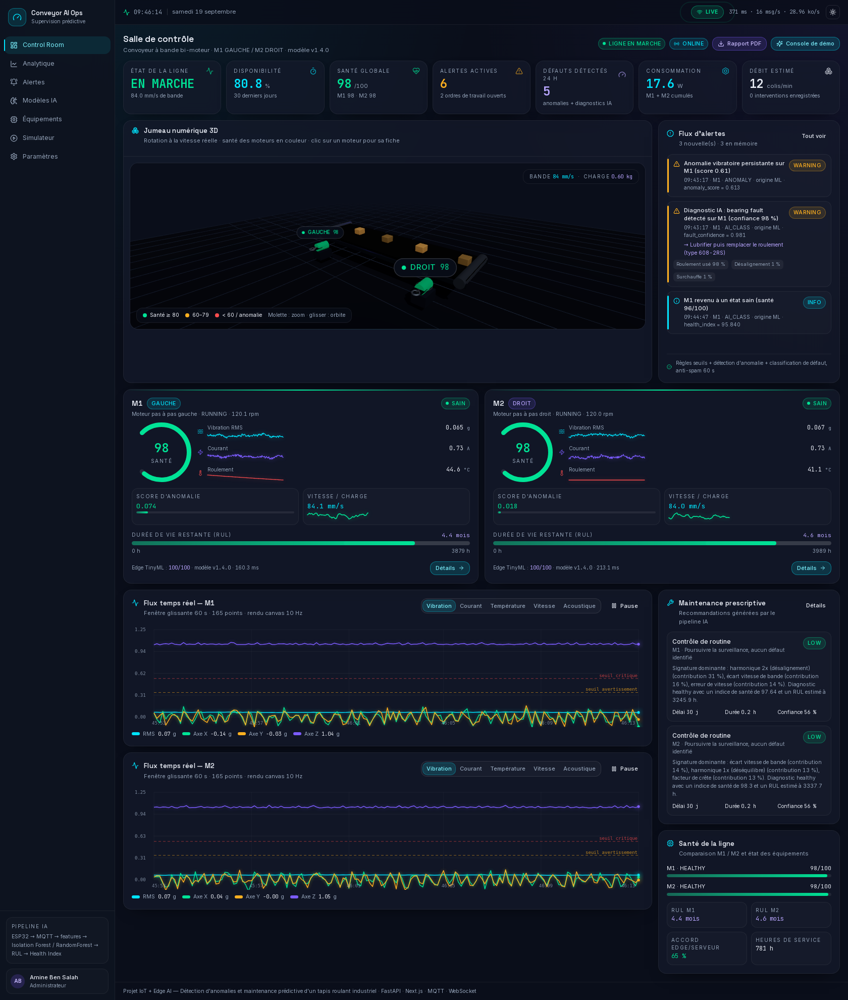
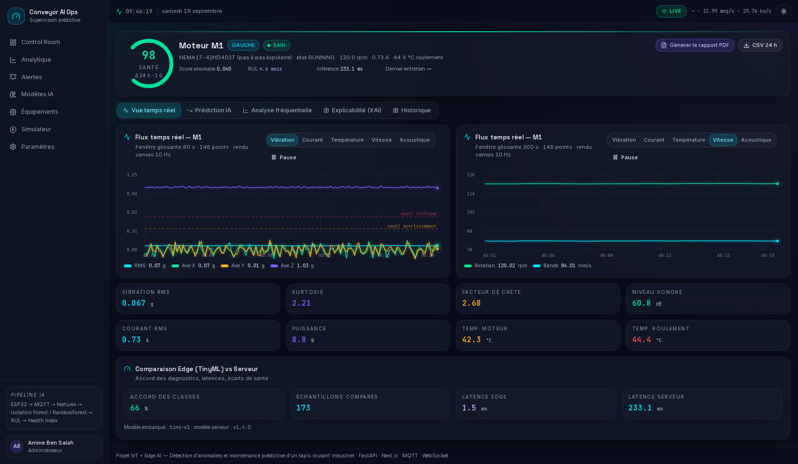
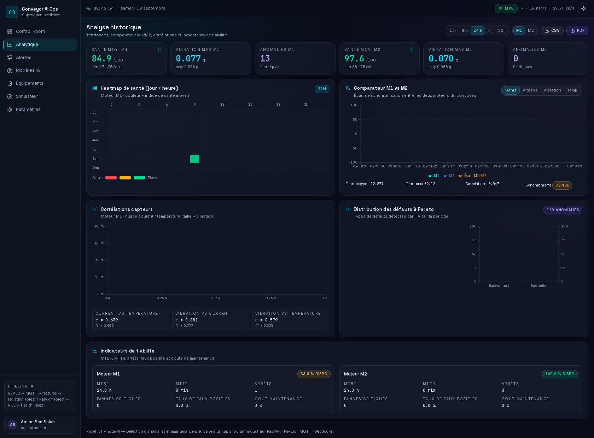
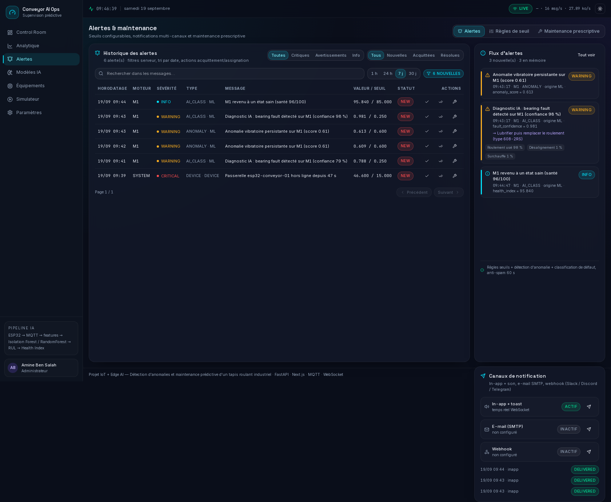
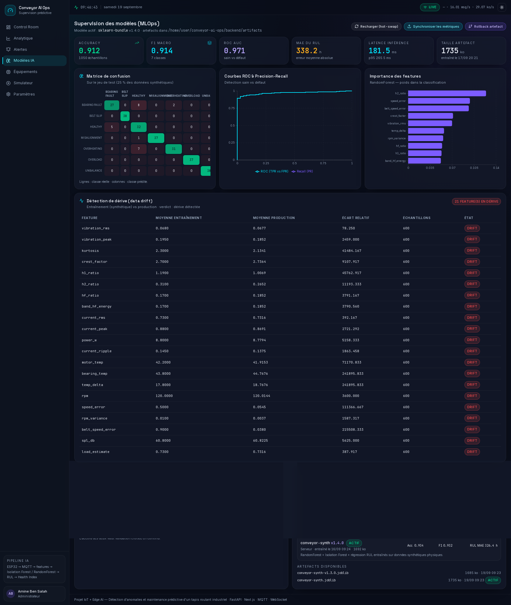
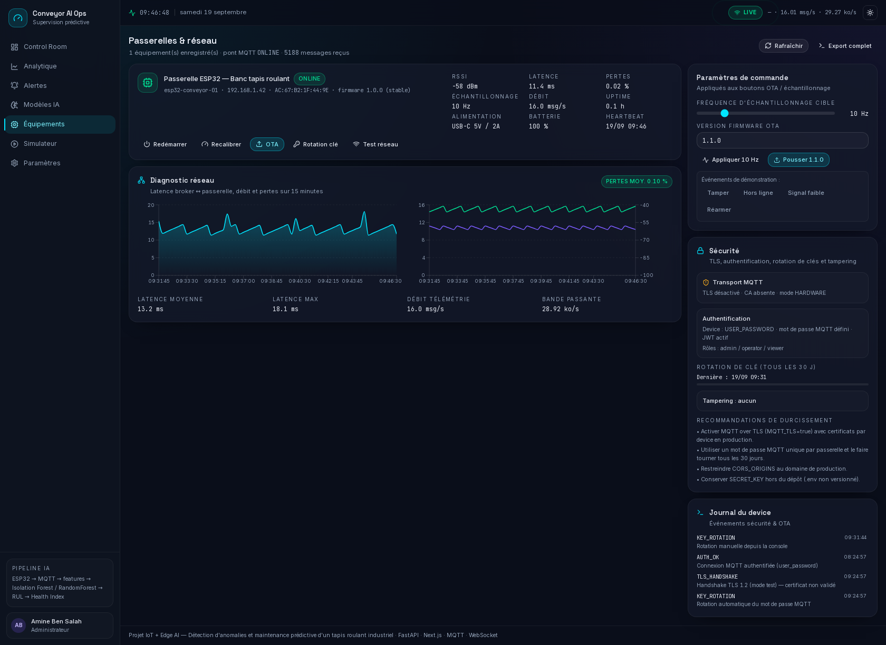
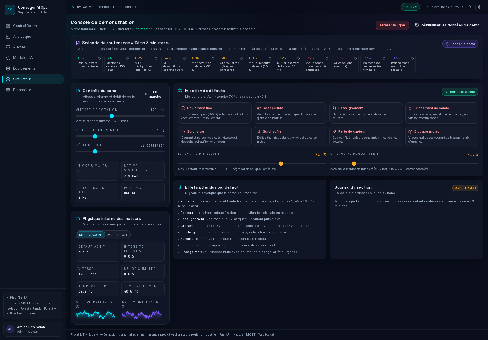
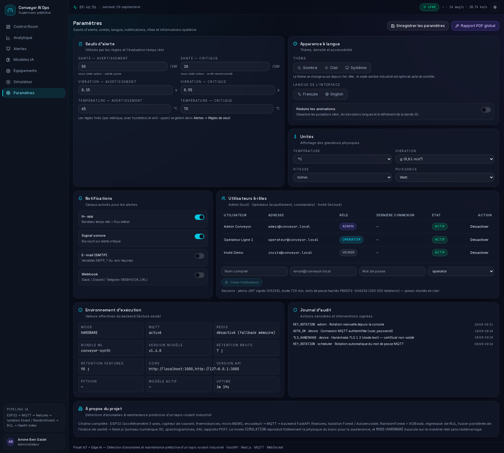
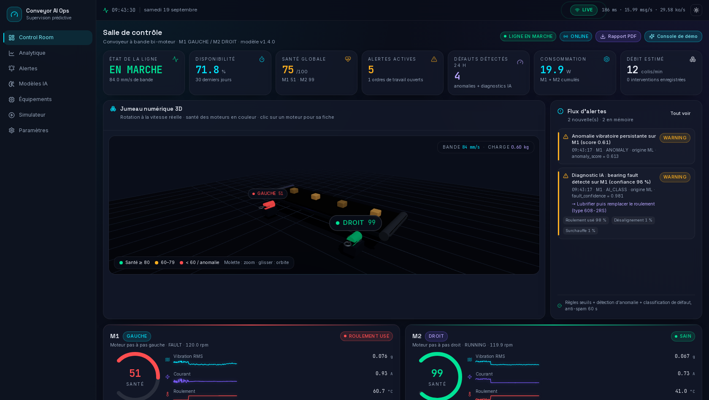
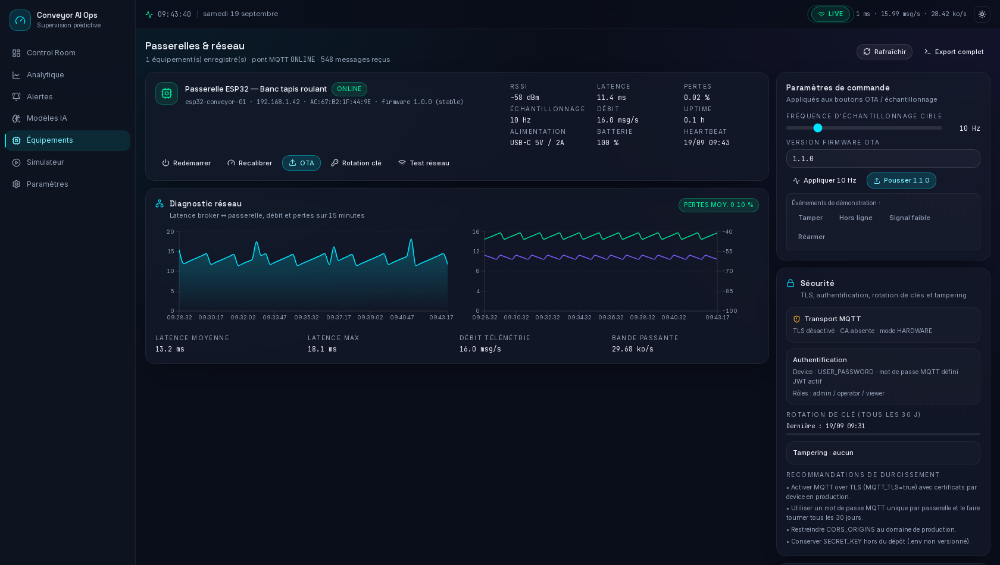

# Conveyor AI Ops — Détection d'anomalies & maintenance prédictive d'un tapis roulant industriel

Système complet **IoT + Edge AI + jumeau numérique** pour un tapis roulant piloté par deux
moteurs pas à pas (M1 = gauche, M2 = droite) : acquisition capteurs sur ESP32, transport MQTT,
inférence IA (anomalie, classification de défaut, durée de vie restante), alerting avec
maintenance prescriptive, tableaux de bord temps réel et rapport PDF.

> **Le projet est immédiatement exécutable sans matériel** : au premier `docker compose up`,
> le mode `SIMULATION` génère un banc physiquement réaliste (vibration, courant, température,
> usure, défauts injectables) et remplit les tableaux de bord. Quand la carte est prête, on
> bascule sur `MODE=HARDWARE` **sans redémarrer le code** : le backend se contente d'écouter
> les trames MQTT de l'ESP32.

---

## Sommaire

1. [Aperçu fonctionnel](#1-aperçu-fonctionnel)
2. [Architecture](#2-architecture)
3. [Démarrage rapide](#3-démarrage-rapide)
4. [Les 8 pages du tableau de bord](#4-les-8-pages-du-tableau-de-bord)
5. [Protocole MQTT](#5-protocole-mqtt)
6. [Pipeline IA](#6-pipeline-ia)
7. [API REST](#7-api-rest)
8. [Variables d'environnement](#8-variables-denvironnement)
9. [Commandes utiles](#9-commandes-utiles)
10. [Passage au matériel réel](#10-passage-au-matériel-réel)
11. [Brancher vos propres modèles IA](#11-brancher-vos-propres-modèles-ia)
12. [Scénario de soutenance (3 minutes)](#12-scénario-de-soutenance-3-minutes)
13. [Captures d'écran](#13-captures-décran)
14. [Dépannage](#14-dépannage)
15. [Arborescence du projet](#15-arborescence-du-projet)

---

## 1. Aperçu fonctionnel

| Domaine | Ce qui est livré |
|---|---|
| **Acquisition** | Firmware ESP32 (`firmware/esp32_conveyor.ino`) : MPU6050 (vibration 3 axes), ACS712 ×2 (courant), 3 × DS18B20 (moteur / roulement / ambiant), micro INMP441 optionnel, encodeur optionnel. Calcul embarqué des 21 caractéristiques + FFT + pré-diagnostic TinyML. |
| **Transport** | MQTT (Mosquitto) : télémétrie 8 Hz, features 1 Hz, inférence edge 1 Hz, statut 5 Hz, heartbeat 1 Hz, commandes descendantes, TLS/ACL par compte. |
| **Backend** | FastAPI (Python 3.11), SQLModel/SQLite (bascule PostgreSQL/TimescaleDB), APScheduler, Redis optionnel, WebSocket temps réel, 88 routes dont 46 endpoints métier. |
| **IA** | Isolation Forest (anomalie) + RandomForest (7 classes) + régression RUL, *fusion* pondérée en indice de santé 0-100, explications XAI, détection de dérive, rollback de version. |
| **Maintenance** | Alertes à hystérésis + anti-flapping, acquittement/assignation, ordres de travail, prescriptions (« Rééquilibrer la poulie », …), journal d'interventions signé, MTBF/MTTR. |
| **Supervision** | Next.js 14 (App Router) : jumeau numérique 3D animé, jauges radiales, courbes néon temps réel, spectre FFT avec marqueurs BPFO/BPFI, waterfall, radar, comparateur M1/M2, heatmap calendaire. |
| **Exploitation** | Docker Compose (backend + frontend + Mosquitto + Redis + simulateur de banc), rapport PDF, exports CSV, rôles admin/opérateur/invité, audit, TLS, rotation de clés. |

---

## 2. Architecture

```
                            ┌──────────────────────────── BANC RÉEL (optionnel) ───────────────────────────┐
                            │  Moteur M1 (gauche)                Moteur M2 (droite)                         │
                            │  NEMA17 + driver A4988             NEMA17 + driver A4988                      │
                            │     │ vibration 3 axes (MPU6050)       │ courant (ACS712)                    │
                            │     │ courant (ACS712)                 │ température pallier (DS18B20)       │
                            │     │ température corps (DS18B20)       │                                     │
                            └─────┴──────────────┬────────────────┴───────────────────────────────────────┘
                                                   │ I2C / ADC / 1-Wire / I2S
                                       ┌───────────▼────────────┐
                                       │  ESP32 « passerelle »  │  firmware/esp32_conveyor.ino
                                       │  • acquisition 500 Hz  │  • 21 features embarquées (1 Hz)
                                       │  • FFT 512 points      │  • pré-diagnostic TinyML (1 Hz)
                                       │  • buffers circulaires │  • commandes descendantes
                                       └───────────┬────────────┘
                                                   │ Wi-Fi / MQTT (TLS optionnel, ACL par compte)
                                       ┌───────────▼────────────┐
                                       │  Mosquitto (broker)    │  1883 / 9001 (WS) / 8883 (TLS)
                                       └───────────┬────────────┘
                     conveyor/m1|m2/telemetry      │      conveyor/cmd/#
                 conveyor/+/features, edge_inference│
                     conveyor/status, heartbeat     │
                     ┌─────────────────────────────┴──────────────────────────────┐
                     │                    BACKEND FastAPI                         │
                     │  ┌────────────┐  ┌─────────────┐  ┌───────────────────┐    │
                     │  │ Ingestion  │→ │ Buffer 10 s │→ │ WebSocket /ws/…   │    │
                     │  │ validation │  │ (mémoire)   │  └─────────┬─────────┘    │
                     │  │  Pydantic  │  └─────────────┘            │              │
                     │  └─────┬──────┘                             │              │
                     │        │ 1 Hz : features (edge sinon serveur) │             │
                     │  ┌─────▼──────────────────────────────────┐  │             │
                     │  │ Moteur IA  (ml/model.py, ml/inference) │  │             │
                     │  │  • Isolation Forest → score d'anomalie │  │             │
                     │  │  • RandomForest     → classe de défaut │  │             │
                     │  │  • Régression       → RUL (heures)     │  │             │
                     │  │  • fusion pondérée  → indice de santé  │  │             │
                     │  └─────┬──────────────────────────────────┘  │             │
                     │        │                                     │             │
                     │  ┌─────▼─────────┐   ┌──────────────┐  ┌─────▼─────────┐   │
                     │  │ Alerteur      │   │ Scheduler    │  │ SQLModel      │   │
                     │  │ seuils + IA   │   │ agrégats/    │  │ SQLite ou     │   │
                     │  │ anti-flapping │   │ rétention    │  │ PostgreSQL    │   │
                     │  └─────┬─────────┘   └──────────────┘  └───────────────┘   │
                     │        │  PDF (ReportLab) · CSV · e-mail · webhook         │
                     └────────┴────────────────────────────────────────────────────┘
                                          │ REST /api/*  +  WS /ws/telemetry
                              ┌───────────▼────────────────────────────┐
                              │      FRONTEND Next.js 14 (App Router)  │
                              │  3D temps réel (react-three-fiber)     │
                              │  Recharts / canvas 60 s glissantes     │
                              │  TanStack Query + Zustand + next-themes│
                              └────────────────────────────────────────┘
```

**Modes de fonctionnement** (variable `MODE`) :

| Mode | Comportement | Usage |
|---|---|---|
| `SIMULATION` (défaut) | Le backend génère lui-même la physique des deux moteurs et alimente toute la chaîne. | Démonstration, soutenance, développement, intégration continue. |
| `HARDWARE` | Plus aucune simulation : le backend n'écoute que le broker MQTT alimenté par l'ESP32. Les endpoints de simulation deviennent des **relais** de commandes vers la carte. | Banc réel. |
| `HYBRID` | Simulation locale **et** écoute MQTT en parallèle : un seul moteur peut venir du matériel. | Mise au point progressive (M1 réel, M2 simulé). |

---

## 3. Démarrage rapide

### 3.1 Avec Docker (recommandé — rien à installer d'autre)

```bash
unzip conveyor-ai-ops.zip && cd conveyor-ai-ops
cp .env.example .env                 # valeurs par défaut prêtes à l'emploi
docker compose up --build            # → http://localhost:3000
```

Le premier démarrage (~2-4 min) : construit les images, **valide l'artefact IA** (et le
ré-entraîne si nécessaire), amorce la base (historique de 24 h, 3 comptes, 9 règles, modèle v1.4.0),
démarre le broker Mosquitto et le simulateur de banc.

| Service | Adresse | Identifiants |
|---|---|---|
| Tableau de bord | http://localhost:3000 | `admin@conveyor.local` / `admin123` |
| API + documentation interactive | http://localhost:8000/docs | — |
| Broker MQTT (TCP / WebSocket) | `localhost:1883` / `localhost:9001` | `conveyor` / `conveyor` |

Variantes :

```bash
docker compose --profile cache up    # + Redis (cash des métriques / pub-sub multi-instances)
docker compose --profile edge up     # + scripts/esp32_simulator.py : banc MQTT externe
docker compose logs -f backend       # suivre l'ingestion en direct
docker compose down -v               # tout arrêter et repartir d'une base propre
```

### 3.2 Sans Docker (installation locale)

```bash
# --- Backend ---
cd backend
python3.11 -m venv .venv && source .venv/bin/activate        # Windows : .venv\Scripts\activate
pip install -r requirements.txt
cp .env.example .env
python -m ml.validate --artifacts ./artifacts || \
  python -m ml.train --samples 150 --out ./artifacts --version v1.4.0 --seed 7
python -m ml.inference --selftest                            # 7/7 attendus
uvicorn app.main:app --reload --port 8000

# --- Frontend (autre terminal) ---
cd frontend
npm install
npm run dev                                                  # → http://localhost:3000
```

Le frontend appelle `/api/*` et `/ws/*` en **relatif** : `next.config.mjs` proxifie vers
`http://127.0.0.1:8000` (aucun CORS à gérer, aucun `localhost` côté navigateur).

### 3.3 Vérifier l'installation

```bash
# --- Contrôles backend (le serveur doit tourner sur :8000) ---
python scripts/seed_db.py --check    # régime nominal : modèle actif, santé, anomalie, classe
python scripts/seed_db.py --drill    # validation dynamique : 3 défauts injectés + retour à la normale
backend/.venv/bin/python backend/tests/test_alert_rules.py   # tests unitaires (hystérésis des règles, disponibilité)
python -m ml.inference --selftest    # 7 défauts + état sain (depuis backend/)
python scripts/esp32_simulator.py monitor  # écoute le flux MQTT (diagnostic de bout en bout)

# --- Contrôles frontend (le frontend doit tourner sur :3000) ---
cd frontend && npm run smoke         # Chromium réel : 8 pages + onglets + captures docs/screenshots/
```

Repères attendus sur un banc sain : **santé ≥ 95**, anomalie ≤ 0,25, classe `HEALTHY`,
RUL ≈ 3 200-3 400 h ; modèle actif `v1.4.0` (exactitude 0,9125 / F1 0,9136 / RUL MAE 338 h).
Toutes ces valeurs de référence sont dans [`data/seed.json`](data/seed.json) (`expected_results`) :
modifiez-les si vous changez de modèle, les deux commandes de contrôle s'y adaptent.

<details>
<summary>Résultats de référence obtenus sur ce dépôt (2026-09-17)</summary>

```
$ python scripts/seed_db.py --check
Modèle actif : conveyor-synth v1.4.0 (acc=0.9125, f1=0.9136, RUL MAE=338.19 h)
M1 : santé 97.8 · anomalie 0.125 · RUL 3267 h · classes ['HEALTHY'] (médiane de 4 relevés)
M2 : santé 97.6 · anomalie 0.129 · RUL 3228 h · classes ['HEALTHY'] (médiane de 4 relevés)
[check] CONFORME

$ python scripts/seed_db.py --drill
BEARING_FAULT M1   75 % → santé min 51.6 · anomalie méd 0.614 · RUL min 404 h · classes ['BEARING_FAULT', …]
BELT_SLIP    M2   80 % → santé min 29.8 · anomalie méd 0.873 · RUL min 117 h · classes ['BELT_SLIP', …]
UNBALANCE    M1   85 % → santé min 58.5 · anomalie méd 0.582 · RUL min 551 h · classes ['UNBALANCE', …]
récupération  M1 après effacement → santé min 59.9 · anomalie méd 0.115 · classes ['HEALTHY', …]
[drill] CONFORME

$ cd frontend && npm run smoke
✔ /  ✔ /motors/M1  ✔ /analytics  ✔ /alerts  ✔ /ml  ✔ /devices  ✔ /simulator  ✔ /settings
8/8 pages conformes
```

</details>

> **Banc nominal** : les deux rouleaux sont mécaniquement solidaires, donc M1 et M2 doivent
> afficher des indicateurs couplés (±1,5 point de santé). Chaque moteur publie **sa propre
> consigne** (le suiveur est consigné à 99,5 % de la tête pour garder la bande sous tension) :
> sans cela, l'écart de synchronisation est lu comme un défaut de vitesse par le modèle.

---

## 4. Les 8 pages du tableau de bord

| Page | Contenu clé |
|---|---|
| **`/` Control Room** | En-tête collant (horloge live, pastille **MQTT LIVE** pulsante, latence), bandeau KPI animé, **jumeau numérique 3D** (bande animée à la vitesse réelle, moteurs colorés selon la santé, clic sur un moteur, OrbitControls), deux cartes moteur (jauge radiale de santé, sparklines, badge de défaut, barre RUL), fil d'alertes temps réel, courbe multi-séries en fenêtre glissante 60 s (pause / reprise / zoom). |
| **`/motors/M1` et `/motors/M2`** | Identité de l'actif + bouton **rapport PDF**, grande jauge de santé avec delta 24 h, bloc de prédiction (RUL + intervalle de confiance + projection de dégradation vs seuil critique), **spectre FFT interactif** avec marqueurs BPFO/BPFI, **spectrogramme waterfall**, courbes synchronisées, **panneau XAI** (contributions horizontales + explication rédigée), radar « signature vs baseline », répartition des probabilités de défaut, historique des anomalies. |
| **`/analytics`** | Sélecteur de période (1 h → 30 j), heatmap calendaire de santé, comparateur **M1 vs M2** (avec écart de synchronisation), nuages de corrélation, distribution des défauts (donut + Pareto), MTBF / MTTR / faux positifs, export CSV et PDF. |
| **`/alerts`** | Tableau avancé (tri, recherche, filtres, pagination), configuration des règles (seuil, hystérésis, durée, anti-spam), canaux in-app / son / e-mail SMTP / webhook (Telegram, Discord, Slack) avec bouton de test, actions acquitter / assigner / commenter / créer un ordre de travail, recommandations prescriptives, journal d'interventions signé. |
| **`/ml`** | Fiches modèles, matrice de confusion, courbes ROC/PR, dérive entraînement↔production, importance des caractéristiques, historique des versions + rollback en un clic, comparaison **edge (TinyML)** vs **serveur**. |
| **`/devices`** | Liste des passerelles, diagnostic réseau (latence, débit, pertes, RSSI), section sécurité (TLS, authentification, rotation de clés, journal de sabotage), actions `reboot` / `recalibrate` / `OTA` / cadence d'échantillonnage / test réseau. |
| **`/simulator`** | Console de démonstration : marche/arrêt, vitesse, charge, débit de colis, **8 défauts injectables** (roulement, déséquilibre, désalignement, glissement, surcharge, surchauffe, perte de capteur, blocage), curseurs d'intensité et de dégradation, effets visibles immédiatement, **scénario « Démo 3 minutes »** avec frise de jalons. |
| **`/settings`** | Seuils d'alerte, unités, langue FR/EN, thème clair/sombre, notifications, rôles admin/opérateur/invité, sessions actives. |

Le **design system** est celui d'une salle de contrôle : fonds `#0A0E1A` / `#0F1420`, surfaces
vitrées `#161B2B`, cyan `#00E5FF` (live), vert `#00E396` (sain), ambre `#FFB020` (vigilance),
rouge `#FF4D4F` (critique), violet `#7C5CFF` (IA), rayons 16 px, Inter/Space Grotesk pour les
titres et JetBrains Mono pour les chiffres, animations désactivables (option *reduce motion*).

---

## 5. Protocole MQTT

Broker : `mosquitto` — TCP 1883, WebSocket 9001, TLS 8883 (activable), ACL par compte
(`conveyor`, `conveyor-backend`, `conveyor-monitor`), mot de passe généré au premier démarrage.

### 5.1 Topics

| Topic | Cadence | Contenu |
|---|---|---|
| `conveyor/m1/telemetry`, `conveyor/m2/telemetry` | 5-10 Hz | Payload complet : vibration 3 axes + RMS/crête/kurtosis/facteur de crête, pics FFT, courant (RMS/crête/puissance), températures (moteur/roulement/ambiant), acoustique (SPL + énergie par bande), vitesse (rpm / pas par seconde / mm/s), état. |
| `conveyor/{m1\|m2}/features` | 1 Hz | Les 21 caractéristiques calculées par la carte (mêmes noms que `backend/ml/features.py`). |
| `conveyor/{m1\|m2}/edge_inference` | 1 Hz | Pré-diagnostic embarqué : indice de santé, score d'anomalie, `is_anomaly`, classe, version du modèle, durée d'inférence. |
| `conveyor/status` | 5 Hz | État de ligne : marche, consigne de vitesse, vitesse de bande, charge, débit de colis, mode. |
| `conveyor/{device}/heartbeat` | 1 Hz | Supervision : uptime, RSSI, heap libre, firmware, IP, capteurs détectés, défauts actifs. |
| `conveyor/cmd/{M1\|M2\|all}/{command}` | à la demande | Commandes descendantes (voir ci-dessous). |
| `conveyor/{device}/command_ack`, `.../network_test` | à la demande | Accusés de réception de la carte. |

### 5.2 Télémétrie (extrait réel)

```json
{
  "device_id": "esp32-conveyor-01", "motor_id": "M1", "ts": 1789583096069,
  "vibration": {"ax": 0.0412, "ay": 0.0471, "az": 1.0132, "rms": 0.0662,
                "peak": 0.2145, "kurtosis": 2.94, "crest_factor": 3.24},
  "fft_peaks": [{"freq": 2.0, "amp": 0.0481}, {"freq": 4.0, "amp": 0.0152}],
  "current": {"rms_a": 0.943, "peak_a": 1.338, "power_w": 11.32},
  "temperature": {"motor_c": 41.5, "bearing_c": 38.9, "ambient_c": 24.0},
  "acoustic": {"spl_db": 52.4, "band_energy": [0.021, 0.044, 0.018, 0.006]},
  "speed": {"rpm": 120.02, "steps_per_s": 640.1, "belt_mm_s": 84.01},
  "state": "RUNNING"
}
```

### 5.3 Inférence (schéma exigé par le cahier des charges)

```json
{
  "motor_id": "M1", "ts": 1789583096069,
  "health_index": 54.7, "anomaly_score": 0.5731, "is_anomaly": false,
  "fault_class": "UNBALANCE",
  "fault_probabilities": {"HEALTHY": 0.04, "UNBALANCE": 0.81, "MISALIGNMENT": 0.09,
                          "BEARING_FAULT": 0.03, "BELT_SLIP": 0.02,
                          "OVERLOAD": 0.01, "OVERHEATING": 0.0},
  "rul_hours": 209.0, "rul_confidence": {"low": 118.0, "high": 298.0},
  "explanation": [{"feature": "vibration_rms", "contribution": 0.42},
                  {"feature": "h1_ratio", "contribution": 0.31}],
  "model_version": "v1.4.0", "inference_ms": 41.8
}
```

### 5.4 Commandes descendantes

| Commande | Paramètres | Effet |
|---|---|---|
| `set_controls` | `running`, `speed_rpm`, `load_kg`, `parcels_per_min` | Pilote la ligne (les deux moteurs restent synchronisés). |
| `calibrate` | — | Réapplique les zéros (offset accéléromètre, zéro courant). |
| `set_sampling` | `hz` | Change la cadence d'échantillonnage embarquée. |
| `reboot` | — | Redémarre la carte. |
| `ota_update` | `version` | Prépare la mise à jour OTA (voir `docs/HARDWARE.md`). |
| `test_network` | — | Mesure latence/RSSI vers le broker et publie le résultat. |
| `inject_fault` | `fault`, `intensity`, `degradation_rate` | Défaut de substitution (banc d'essai, `ENABLE_BENCH_TEST`). |
| `clear_fault` | — | Efface tous les défauts. |
| `run_scenario` / `stop_scenario` | `name` | Rejoue / interrompt la démo de 3 minutes sur le banc. |
| `rotate_key` | — | Rotation du secret MQTT du device. |

Détails complets (incluant les commandes acceptées, les tolérances de validation et les
exemples `mosquitto_pub`) : [`docs/MQTT_PROTOCOL.md`](docs/MQTT_PROTOCOL.md).

---

## 6. Pipeline IA

```
capteurs ──► 21 caractéristiques ──► ┌────────────────────┐
 (500 Hz)     (1 Hz)                 │ Isolation Forest   │──► score d'anomalie 0-1
                                     └────────────────────┘        │
                                     ┌────────────────────┐        │   fusion pondérée
                                     │ RandomForest 7 cls │──► classe + probabilités
                                     └────────────────────┘        │        │
                                     ┌────────────────────┐        │        ▼
                                     │ Régression RUL     │──► heures de vie restantes
                                     └────────────────────┘                 │
                                                                     INDICE DE SANTÉ 0-100
```

* **Indice de santé** = `100 − 62·max(0, anomalie − 0,28)/0,72 − 20·(pire composant) − 12·(thermique) − 8·(usure)`
  → un moteur sain se maintient au-dessus de 96, un déséquilibre à 85 % descend vers 55-65.
* **RUL** : base de Weibull (6 000 h) modulée par la pente de dégradation, avec garde-fou
  anti-bruit (médiane du tiers initial vs final) → σ ≈ 41 h sur banc nominal.
* **XAI** : chaque diagnostic est accompagné des 4 contributions dominantes + texte explicatif,
  ce qui rend l'alerte défendable devant un jury ou un responsable maintenance.
* **Anti-flapping** : 3 inférences concordantes + temporisation (90 s IA, 120 s anomalie)
  avant publication d'une alerte, plus verrouillage de classe 2 coups et lissage EMA (α = 0,30).
* **Maintenance prescriptive** : chaque classe de défaut est associée à une action, un délai
  et un niveau de priorité — utilisés pour créer automatiquement les ordres de travail.

Entraînement, réglages et évaluation : [`docs/ML_PIPELINE.md`](docs/ML_PIPELINE.md).
Modèles de référence actuels : exactitude **0,9125**, F1 macro **0,9136**, ROC AUC **0,9712**,
erreur RUL **338 h** sur données synthétiques physiques (1 050 échantillons, 7 classes).

---

## 7. API REST

88 routes exposées ; les 46 principales (documentation interactive sur `/docs`) :

| Groupe | Endpoints |
|---|---|
| **État** | `GET /api/health`, `GET /api/overview`, `GET /api/system/info` |
| **Moteurs** | `GET /api/motors`, `GET /api/motors/{id}`, `.../telemetry`, `.../features`, `.../health`, `.../prediction`, `.../degradation`, `.../radar`, `.../fft`, `.../spectrogram`, `.../anomalies`, `.../xai`, `.../interventions`, `.../work-orders`, `.../report`, `.../export.csv` |
| **Analyse** | `GET /api/analytics/{summary,heatmap,comparison,correlation,fault-distribution,reliability,hourly,export.csv,report}` |
| **Alertes & maintenance** | `GET|PATCH|DELETE /api/alerts…`, `GET|POST|PUT|PATCH|DELETE /api/rules…`, `GET /api/maintenance/{prescriptions,work-orders,interventions,stats}` |
| **IA** | `GET /api/models`, `.../metrics`, `.../edge-comparison`, `.../health`, `.../rollback-candidates`, `POST .../rollback`, `.../reload`, `POST .../sync` |
| **Équipements** | `GET /api/devices`, `.../network`, `.../security`, `.../{id}/logs`, `POST /api/devices/{id}/command`, `.../simulate-network-event`, `.../reset-tamper` |
| **Simulateur** | `GET /api/simulator/state`, `.../faults`, `POST .../control`, `.../inject-fault`, `.../clear-faults`, `.../scenario`, `.../stop-scenario`, `.../fault-sequence`, `.../reset-data` |
| **Auth** | `POST /api/auth/login`, `GET /api/auth/me`, `GET|POST /api/auth/users` |
| **Rapports** | `POST /api/reports/generate`, `GET /api/export/full.csv`, `GET /api/analytics/report` |
| **Temps réel** | `WS /ws/telemetry` (télémétrie, features, inférences, alertes, statut, scénario) |

Exemples :

```bash
# Connexion
TOKEN=$(curl -s -X POST localhost:8000/api/auth/login \
  -H 'Content-Type: application/json' \
  -d '{"email":"admin@conveyor.local","password":"admin123"}' | python -c "import sys,json;print(json.load(sys.stdin)['access_token'])")

# Injecter un déséquilibre de 85 % sur M1
curl -X POST localhost:8000/api/simulator/inject-fault -H 'Content-Type: application/json' \
  -d '{"motor_id":"M1","fault":"UNBALANCE","intensity":85}'

# Rapport PDF d'un moteur
curl -o rapport-M1.pdf localhost:8000/api/motors/M1/report

# Rapport global (M1 + M2) — POST uniquement
curl -X POST localhost:8000/api/reports/generate -H 'Content-Type: application/json' \
  -d '{"motor_id":"M1","period_hours":24,"format":"pdf"}' -o rapport.pdf
```

Détail des paramètres, schémas et codes d'erreur : [`docs/API_REFERENCE.md`](docs/API_REFERENCE.md).

---

## 8. Variables d'environnement

Le fichier `.env.example` (racine) est commenté ligne à ligne. Les plus importantes :

| Variable | Défaut | Rôle |
|---|---|---|
| `MODE` | `SIMULATION` | `SIMULATION` \| `HARDWARE` \| `HYBRID` — bascule à chaud via l'API (`POST /api/models/reload` recharge aussi l'IA). |
| `SIMULATE_ON_M1` / `SIMULATE_ON_M2` | `true` | En `HYBRID`, choisit les moteurs simulés. |
| `SIM_HZ` / `SIM_PUBLISH_MQTT` | `8` / `false` | Cadence du simulateur interne et publication MQTT parallèle. |
| `MQTT_ENABLED` / `MQTT_HOST` / `MQTT_PORT` | `false` / `mosquitto` / `1883` | Raccordement au broker. |
| `MQTT_USERNAME` / `MQTT_PASSWORD` / `MQTT_TLS` | vide / vide / `false` | Authentification et chiffrement (`8883` + `MQTT_CA_CERT`). |
| `DATABASE_URL` | `sqlite:///./data/conveyor.db` | SQLite par défaut ; `postgresql+psycopg://conveyor:conveyor@db:5432/conveyor` pour PostgreSQL/TimescaleDB. |
| `REDIS_ENABLED` / `REDIS_URL` | `false` / `redis://redis:6379/0` | Cache et pub/sub multi-instances. |
| `SECRET_KEY` | *à changer* | Signature des jetons JWT. |
| `RATE_LIMIT_PER_MINUTE` | `600` | Limitation de débit par IP. |
| `AI_CONFIRMATIONS` / `AI_DEBOUNCE_S` | `3` / `90` | Anti-flapping des alertes IA. |
| `ANOMALY_CONFIRMATIONS` / `ANOMALY_DEBOUNCE_S` | `3` / `120` | Idem pour les alertes d'anomalie. |
| `RAW_RETENTION_DAYS` / `FEATURE_RETENTION_DAYS` | `7` / `90` | Rétention (purgée par le scheduler) avec agrégats horaires conservés. |
| `ALERT_EMAIL_ENABLED`, `SMTP_*`, `ALERT_WEBHOOK_ENABLED`, `WEBHOOK_URL` | — | Canaux de notification (le canal « son » est géré côté navigateur). |
| `REPORT_COMPANY` / `REPORT_AUTHOR` | — | En-tête des rapports PDF. |
| `CORS_ORIGINS` | `http://localhost:3000` | Origines autorisées (restrictif par défaut). |

---

## 9. Commandes utiles

```bash
# --- IA ---
cd backend
python -m ml.train --samples 150 --out ./artifacts --version v1.4.0 --seed 7   # entraîner
python -m ml.train --quick                                                     # jeu réduit (CI)
python -m ml.validate --artifacts ./artifacts                                  # valider (code 1 ⇒ ré-entraîner)
python -m ml.inference --selftest                                              # 7 défauts + sain

# --- Données ---
python scripts/seed_db.py                       # fiche du banc
python scripts/seed_db.py --apply               # appliquer data/seed.json à la base
python scripts/seed_db.py --apply --reset --history-hours 24
python scripts/seed_db.py --check               # contrôle des valeurs de référence (régime nominal)
python scripts/seed_db.py --drill               # validation dynamique (défauts injectés + récupération)
python scripts/seed_db.py --drill --drill-window 90   # fenêtre d'observation allongée

# --- Tests ---
backend/.venv/bin/python backend/tests/test_alert_rules.py   # règles d'alerte & disponibilité (aucune dépendance)
cd frontend && npm run smoke && cd ..                        # navigateur réel : 8 pages, onglets, captures

# --- Banc MQTT sans matériel ---
python scripts/esp32_simulator.py run --host localhost          # publie à 8 Hz
python scripts/esp32_simulator.py --scenario demo-3min          # rejoue la démo de 3 min
python scripts/esp32_simulator.py fault --motor M2 --fault BEARING_FAULT --intensity 70
python scripts/esp32_simulator.py control --speed 150 --load 1.2
python scripts/esp32_simulator.py monitor                       # diagnostic du flux MQTT
python scripts/esp32_simulator.py reset                         # retour au nominal

# --- Frontend ---
cd frontend
npm run dev          # développement
npm run build        # build de production
npm run start        # servir le build

# --- Docker ---
docker compose up --build                     # stack complète (SIMULATION)
docker compose --profile cache up             # + Redis
docker compose --profile edge up              # + simulateur de banc externe
docker compose exec backend python -m ml.train --samples 200 --seed 11
```

---

## 10. Passage au matériel réel

1. **Câbler** le banc selon le tableau de connexions en tête de `firmware/esp32_conveyor.ino`
   (GPIO, alimentations, masse commune, résistance de tirage 4,7 kΩ sur le bus 1-Wire).
2. **Téléverser** le firmware (Arduino IDE ou `firmware/platformio.ini` avec `pio run -t upload`).
3. **Créer le compte MQTT du device** (déjà fait par le broker au premier démarrage) et
   renseigner `MQTT_HOST` / `MQTT_USERNAME` / `MQTT_PASSWORD` en tête du sketch.
4. **Basculer le backend** : `MODE=HARDWARE`, `MQTT_ENABLED=true`, puis
   `docker compose up -d --force-recreate backend` (ou simplement `POST /api/models/reload`
   si l'on change les seuils à chaud).
5. **Contrôler** la réception : page `/devices` (heartbeat, RSSI, cadence) et
   `python scripts/esp32_simulator.py monitor`.
6. **Vérifier l'IA** : page `/ml` → comparaison *edge vs serveur* ; les défauts réels
   (déséquilibre, roulement, glissement) doivent produire les mêmes classes que sur banc simulé.
7. **Colmater les écarts** : si la ligne de base réelle diffère (vibration RMS, courant),
   ajuster `BASELINE` dans `backend/ml/features.py` puis ré-entraîner — la procédure complète
   est décrite dans [`docs/HARDWARE.md`](docs/HARDWARE.md).

Les endpoints `/api/simulator/*` restent utilisables en `MODE=HARDWARE` : ils **relaient**
les commandes sur `conveyor/cmd/#` au lieu de piloter une physique locale.

---

### 10.1 Le jour du câblage : suivez [`docs/INTEGRATION_MATERIEL.md`](docs/INTEGRATION_MATERIEL.md)

Ce guide décrit la **chaîne complète** (capteur → MQTT → backend → WebSocket → écran), la
correspondance **topic ↔ élément d'interface**, les vérifications à chaque étape et un arbre de
diagnostic. Procédure résumée :

```bash
# 1) broker (comptes créés automatiquement au premier démarrage)
docker compose up -d mosquitto

# 2) backend en mode matériel (MODE=HARDWARE, MQTT_ENABLED=true dans backend/.env)
cd backend && .venv/bin/python -m uvicorn app.main:app --host 0.0.0.0 --port 8000

# 3) interface
cd ../frontend && npm run build && npm run start        # → http://localhost:3000

# 4) flash de la carte, puis vérification topic par topic
cd ../firmware && pio run -t upload && pio device monitor -b 115200
mosquitto_sub -h localhost -u conveyor-monitor -P <mdp> -t 'conveyor/#' -v
curl -s localhost:8000/api/overview | python -m json.tool   # mqtt.status doit valoir ONLINE
```

Sans broker Mosquitto, un broker de test est fourni :

```bash
backend/.venv/bin/pip install amqtt==0.11.3
backend/.venv/bin/python tools/mqtt_broker_test.py      # écoute sur 0.0.0.0:1883
# puis, dans un autre terminal, le banc ESP32 simulé publie sur les mêmes topics :
backend/.venv/bin/python scripts/esp32_simulator.py run --host 127.0.0.1
```

### 10.2 Comment le matériel apparaît dans l'interface

| Topic publié par la carte | Ce que vous voyez à l'écran |
|---|---|
| `conveyor/m1|m2/telemetry` (8 Hz) | courbes canvas 60 s, jauges de santé et de RUL, valeurs instantanées, jumeau 3D (vitesse + couleur) |
| `conveyor/m1|m2/features` (1 Hz) | radar « signature vs baseline », onglets FFT/historique de la fiche moteur, corrélations |
| `conveyor/m1|m2/edge_inference` (1 Hz) | panneau **Edge (TinyML) vs Serveur** : accord des diagnostics, latences comparées |
| `conveyor/status` (5 Hz) | bandeau « État de la ligne » : marche/arrêt, mm/s de bande, charge, colis/min |
| `conveyor/esp32-conveyor-01/heartbeat` (1 Hz) | page **Équipements** : ONLINE, RSSI, latence, pertes, uptime, firmware, mémoire libre |
| `conveyor/cmd/{cible}/{commande}` | boutons **Simulateur** (défauts, vitesse, charge) et **Équipements** (reboot, recalibrate, OTA) appliqués par la carte |

La carte réelle se substitue au banc simulé **sur les mêmes topics** : le reste de
l'application (IA, alertes, prescriptions, PDF, historique, ordres de travail) est inchangé.

### 10.3 Vérifié de bout en bout dans ce dépôt

```
broker MQTT de test        → ONLINE · backend MODE=HARDWARE : 1 940+ messages ingérés
banc ESP32 simulé (8 Hz)   → 2 moteurs, 5 familles de topics
interface                  → badge LIVE, 16 msg/s, 29 ko/s, santé M1 94,9 / M2 99,0
page Équipements           → passerelle ONLINE · RSSI −58 dBm · latence 11,4 ms · pertes 0,02 %
commande interface → carte  → conveyor/cmd/M1/inject_fault → BEARING_FAULT (confiance 79 %)
                             → ordre de travail créé : « Remplacer le roulement »
```

---

## 11. Brancher vos propres modèles IA

Le backend ne dépend d'**aucune** bibliothèque de deep learning : il consomme un artefact
`joblib` exposant une interface stable (`backend/ml/model.py` → `ConveyorAIEngine`).

```bash
# 1. Entraîner vos modèles (TensorFlow, PyTorch, XGBoost…) sur vos données réelles
# 2. Exporter un artefact au format d'échange :
python - <<'PY'
import joblib
from ml.model import ConveyorAIEngine          # adaptateur du projet
engine = ConveyorAIEngine(my_anomaly, my_classifier, my_rul, scaler, metadata={...})
joblib.dump(engine, "artifacts/conveyor-reel.joblib")
PY

# 3. Déclarer le nouvel artefact
echo "ML_ACTIVE_BUNDLE=conveyor-reel" >> backend/.env
echo "ML_MODEL_VERSION=v2.0.0" >> backend/.env
curl -X POST localhost:8000/api/models/reload  # rechargement à chaud, aucun redémarrage
```

Points d'attention :

* **Ordre des caractéristiques** : `ml/features.py :: FEATURE_NAMES` (21 valeurs) doit correspondre
  exactement à ce que publie la carte sur `conveyor/{m1|m2}/features`.
* **Sorties attendues** : probabilités par classe (`fault_probabilities`), score d'anomalie
  normalisé 0-1, RUL en heures + intervalle de confiance.
* **Versionnage** : renseignez `metadata` (exactitude, F1, RUL MAE, date) : la page `/ml`
  affiche l'historique et permet le **rollback** vers la version précédente en un clic.
* **Dérive** : `GET /api/models/metrics` compare les distributions d'entraînement et de
  production (PSI par caractéristique) ; surveillez-la après chaque changement de banc.
* **Seuil d'anomalie** : `is_anomaly = score > 0,6` (`ml/model.py`) et la porte de sécurité
  `ANOMALY_GATE = 0,32` — à recalibrer sur vos données via `ml/validate.py`.

---

## 12. Scénario de soutenance (3 minutes)

Le scénario est identique dans l'interface (`/simulator` → **Démo 3 minutes**), dans le
backend (`DEMO_SCENARIO_STEPS`) et sur la carte (`runLocalScenario()`), ce qui garantit la
même démonstration quel que soit le matériel disponible. Jalons :

| Temps | Action | Ce que le jury observe |
|---|---|---|
| 0:00 | Remise à zéro, ligne nominale | Santé > 96, courbes stables, aucun défaut |
| 0:08 | Montée en cadence (150 rpm) | Le jumeau 3D accélère, la vitesse M1/M2 se suit |
| 0:22 | M1 : déséquilibre léger (45 %) | Vibration RMS monte, jauge M1 passe en vert-ambre |
| 0:40 | M1 : déséquilibre aggravé (85 %) | **Alerte** `THRESHOLD` + diagnostic **UNBALANCE**, santé ≈ 55-65, RUL ≈ 200-300 h |
| 0:58 | — | Création automatique d'une **prescription** (« Rééquilibrer la poulie ») et d'un **ordre de travail** |
| 1:00 | M2 : défaut de roulement (55 %) | Kurtosis et énergie haute fréquence en hausse, marqueurs BPFO excités sur le spectre |
| 1:25 | Charge lourde (1,6 kg) | Courant et température suivent la charge (corrélation visible sur `/analytics`) |
| 1:45 | M2 : surchauffe roulement (70 %) | Alerte thermique, dérive visible sur le heatmap |
| 2:05 | M1 : glissement de bande (60 %) | Chute de vitesse, écart bande/moteur, alarme critique |
| 2:25 | M2 : blocage moteur | Alerte critique + journal de sécurité |
| 2:38 | Arrêt de ligne puis remise en état | Santé remonte à 97+ : la boucle de maintenance est fermée |
| 3:00 | Génération du **rapport PDF** | Synthèse signée : KPI, RUL, historique des alertes, plan d'action |

Checklist avant de présenter : [`docs/DEMO_SOUTENANCE.md`](docs/DEMO_SOUTENANCE.md).

---

## 13. Captures d'écran

Les captures ci-dessous sont **réelles** : elles sont produites automatiquement par
`cd frontend && npm run smoke` (Chromium, 1680 × 950, données du simulateur en marche) et
enregistrées dans [`docs/screenshots/`](docs/screenshots/). Relancez la commande pour les
régénérer après vos propres modifications.

### 13.1 Salle de contrôle (`/`)



### 13.2 Fiche moteur (`/motors/M1`)



### 13.3 Analyse historique (`/analytics`)



### 13.4 Alertes & maintenance (`/alerts`)



### 13.5 MLOps (`/ml`)



### 13.6 Passerelles & réseau (`/devices`)



### 13.7 Console de démonstration (`/simulator`)



### 13.8 Paramètres (`/settings`)



### 13.9 Chaîne matérielle réelle (MODE=HARDWARE + MQTT)

Ces deux captures sont prises avec exactement le même code, mais **alimenté par le bus MQTT**
(backend `MODE=HARDWARE`, télémétrie publiée par la passerelle ESP32 — ici le banc simulé qui
parle le même protocole). Elles montrent où l'on voit, à l'écran, que la donnée vient du
matériel : pastille LIVE, débit en msg/s, et page Équipements alimentée par le heartbeat.





À vérifier sur chaque écran :

| Écran | Attendu |
|---|---|
| `/` Control Room | En-tête avec horloge qui avance + pastille verte pulsante « LIVE » (latence en ms), bandeau KPI animé, jumeau 3D centré avec bande en mouvement et colis, deux cartes moteur à droite, fil d'alertes, courbes glissantes 60 s. |
| `/motors/M1` | Grande jauge de santé cyan, bloc de prédiction avec bande de confiance RUL, spectre FFT avec pics annotés BPFO/BPFI, waterfall dense, panneau XAI avec barres horizontales. |
| `/analytics` | Heatmap calendaire colorée, comparateur M1/M2 côte à côte, donut de répartition des défauts, tableau MTBF/MTTR/arrêt cumulé. |
| `/alerts` | Tables d'alertes et de règles, badges de sévérité, boutons acquitter / ordre de travail, canaux de notification. |
| `/ml` | Fiches modèles (serveur / edge), matrice de confusion 7 × 7, courbe ROC avec AUC affichée, histogramme de dérive, historique des versions. |
| `/devices` | Carte de la passerelle ESP32 (vert « ONLINE »), latence/RSSI en direct, section sécurité avec dernière rotation de clé. |
| `/simulator` | Grille de 8 boutons de défauts avec icônes et descriptions, curseurs d'intensité, frise du scénario **Démo 3 minutes**. |
| `/settings` | Seuils d'alerte éditables, canaux de notification avec bouton de test, utilisateurs et rôles, état de l'environnement. |

Un banc vide (avant le premier tick) affiche des **squelettes animés** et non des cadres vides :
les buffers temps réel sont préremplis au démarrage pour que la démonstration soit immédiate.

---

## 14. Dépannage

| Symptôme | Cause probable | Correctif |
|---|---|---|
| Les courbes ne bougent pas | Backend en `MODE=HARDWARE` sans trame MQTT | Revenir en `SIMULATION` ou démarrer `scripts/esp32_simulator.py`. |
| `MQTT : OFFLINE` dans l'en-tête | Broker inaccessible ou identifiants erronés | `docker compose logs mosquitto`; vérifier `MQTT_USERNAME`/`MQTT_PASSWORD`; `mosquitto_sub -h localhost -p 1883 -u conveyor -P conveyor -t 'conveyor/#' -v`. |
| Page affichée mais **inerte** (horloge figée, badge `OFFLINE`, KPI vides, aucun graphique) | Échec d'hydratation React : un contenu dépendant du client (heure, aléatoire) diffère du HTML pré-rendu, React abandonne tout le rendu | Vérifier `npm run smoke` (il détecte l'erreur) ; garde-fou côté code : `useClock()` renvoie `null` avant montage et le repli du spectre FFT est déterministe. Symptôme visible dans la console : `Text content did not match server-rendered HTML`. |
| Alerte qui ne se referme jamais (« chute de vitesse 119 tr/min < 90 tr/min ») | Signe de l'hystérésis inversé pour les règles « en dessous de » | Corrigé dans `app/services/common.py` (`rule_still_breached`, signe selon l'opérateur), couvert par `backend/tests/test_alert_rules.py`. |
| Disponibilité différente entre la salle de contrôle et `/analytics` | Deux formules concurrentes | Une seule source : `app/services/reliability.py` (`availability_pct`), utilisée par `/api/overview` et `/api/analytics/reliability`. |
| RUL très dispersée | Fenêtre d'historique trop courte après un redémarrage | Laisser tourner 2-5 minutes : le lissage EMA et la médiane stabilisent la valeur (σ ≈ 70 h). |
| Alertes IA en rafale au démarrage | Anti-flapping désactivé ou `AI_CONFIRMATIONS=1` | Remettre `AI_CONFIRMATIONS=3` et `AI_DEBOUNCE_S=90`. |
| `ml.validate` échoue au build Docker | Artefact absent ou incompatible | `python -m ml.train --samples 150 --out ./artifacts --version v1.4.0 --seed 7`. |
| Frontend : erreur de connexion API | Proxy désactivé ou backend sur un autre port | Vérifier `frontend/next.config.mjs` (`/api` → `http://127.0.0.1:8000`). |
| Base verrouillée après un arrêt brutal | WAL SQLite resté ouvert | `rm backend/data/conveyor.db*` puis redémarrer (une base neuve est ré-amorcée). |

Base de connaissances complète : [`docs/TROUBLESHOOTING.md`](docs/TROUBLESHOOTING.md).

---

## 15. Arborescence du projet

```
conveyor-ai-ops/
├── docker-compose.yml            # mosquitto + backend + frontend (+ redis, + simulateur)
├── .env.example                  # toutes les variables, commentées
├── README.md                     # ce fichier
├── firmware/
│   ├── esp32_conveyor.ino        # firmware complet (capteurs, features, TinyML, MQTT, commandes)
│   └── platformio.ini            # build PlatformIO équivalent au sketch Arduino
├── data/
│   └── seed.json                 # description du banc : actifs, seuils, comptes, scénario
├── scripts/
│   ├── esp32_simulator.py        # banc ESP32 simulé (publie le protocole MQTT, injecte des défauts)
│   └── seed_db.py                # amorçage / vérification de la base
├── tools/
│   └── mqtt_broker_test.py       # broker MQTT de test (sans Docker) pour valider la chaîne matérielle
├── mosquitto/
│   ├── mosquitto.conf            # 1883 + 9001 + TLS 8883, ACL, persistance
│   ├── acl                       # droits par compte (moindre privilège)
│   ├── entrypoint.sh             # création des comptes au premier démarrage
│   └── certs/generate-certs.sh   # génération CA + serveur + device
├── backend/
│   ├── Dockerfile · docker-entrypoint.sh · requirements.txt · .env.example
│   ├── app/
│   │   ├── main.py               # application, cycle de vie, middlewares
│   │   ├── config.py db.py models.py schemas.py security.py realtime.py
│   │   ├── routers/              # 9 routeurs (auth, motors, analytics, alerts, devices,
│   │   │                         #   ml_ops, simulator, system, ws)
│   │   └── services/             # ingestion, ml_service, alerting, simulator, mqtt_client,
│   │                             #   scheduler, reporting, seed
│   ├── ml/
│   │   ├── physics.py            # modèle physique du banc (vibration, thermique, usure)
│   │   ├── features.py           # 21 caractéristiques + baseline
│   │   ├── synthetic.py          # génération du jeu de données
│   │   ├── model.py              # fusion, règles, RUL, moteur heuristique de secours
│   │   ├── train.py              # entraînement (CLI)
│   │   ├── validate.py           # contrôle qualité de l'artefact (utilisé par Docker)
│   │   └── inference.py          # auto-test 7 défauts + sain
│   ├── artifacts/                # modèle entraîné (.joblib) + métriques
│   └── data/                     # bases SQLite (créées au démarrage)
├── frontend/
│   ├── next.config.mjs           # proxy /api, /ws → backend
│   ├── scripts/smoke.mjs         # test navigateur (8 pages + onglets) et captures d'écran
│   ├── src/app/                  # 8 pages (App Router)
│   ├── src/components/           # ui, charts, three, layout, dashboard, motors, simulator
│   └── src/lib/                  # api, socket, store, hooks, types, format, providers
└── docs/
    ├── ARCHITECTURE.md           # composants, flux, choix techniques
    ├── MQTT_PROTOCOL.md          # topics, payloads, commandes, sécurité
    ├── API_REFERENCE.md          # endpoints, paramètres, exemples
    ├── ML_PIPELINE.md            # caractéristiques, modèles, métriques, XAI, dérive
    ├── HARDWARE.md               # câblage, calibration, OTA, TLS, mise en service
    ├── DEPLOYMENT.md             # Docker, PostgreSQL/TimescaleDB, Redis, reverse proxy
    ├── DEMO_SOUTENANCE.md        # scénario, checklist, arguments techniques
    ├── INTEGRATION_MATERIEL.md   # câblage → interface : chaîne complète, topics ↔ écrans
    ├── TROUBLESHOOTING.md        # pannes, diagnostic, journal des correctifs
    └── screenshots/              # captures réelles (générées par npm run smoke)
```

---

### Licence & contact

Projet pédagogique d'ingénierie (IoT, edge computing, IA industrielle). Les comptes et clés
livrés sont des valeurs de démonstration : changez `SECRET_KEY`, les mots de passe et les
certificats avant tout déploiement réel.
